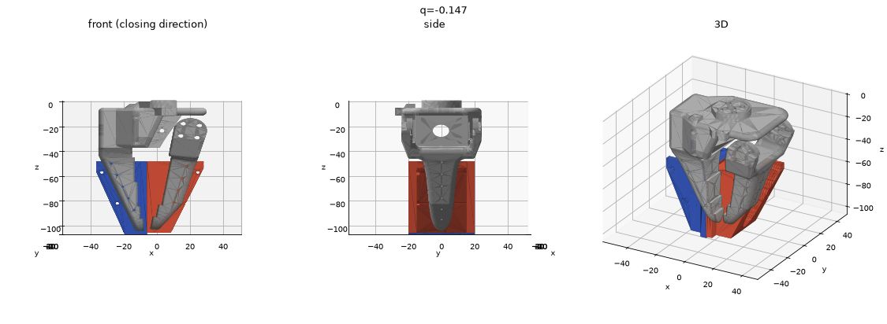
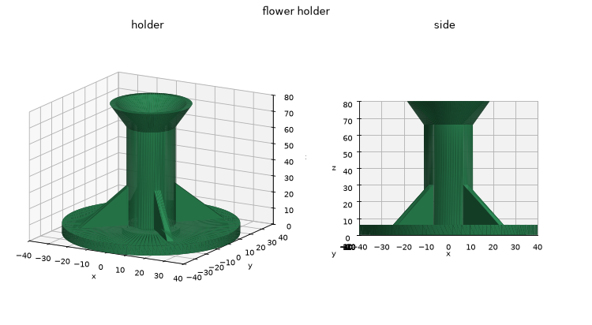
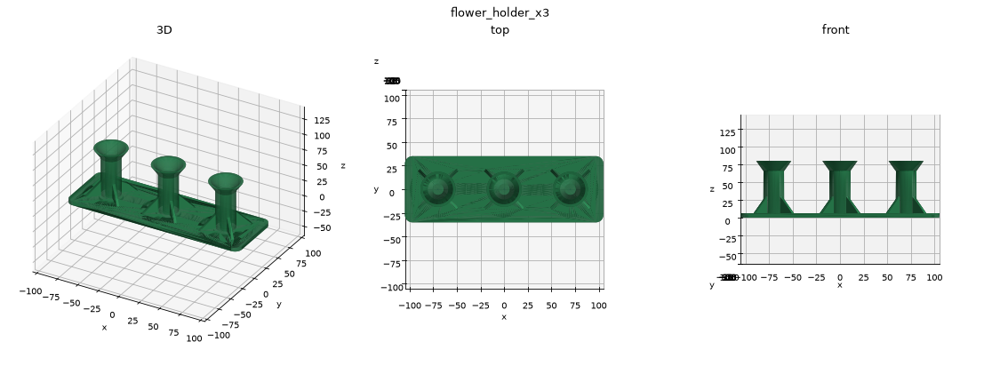
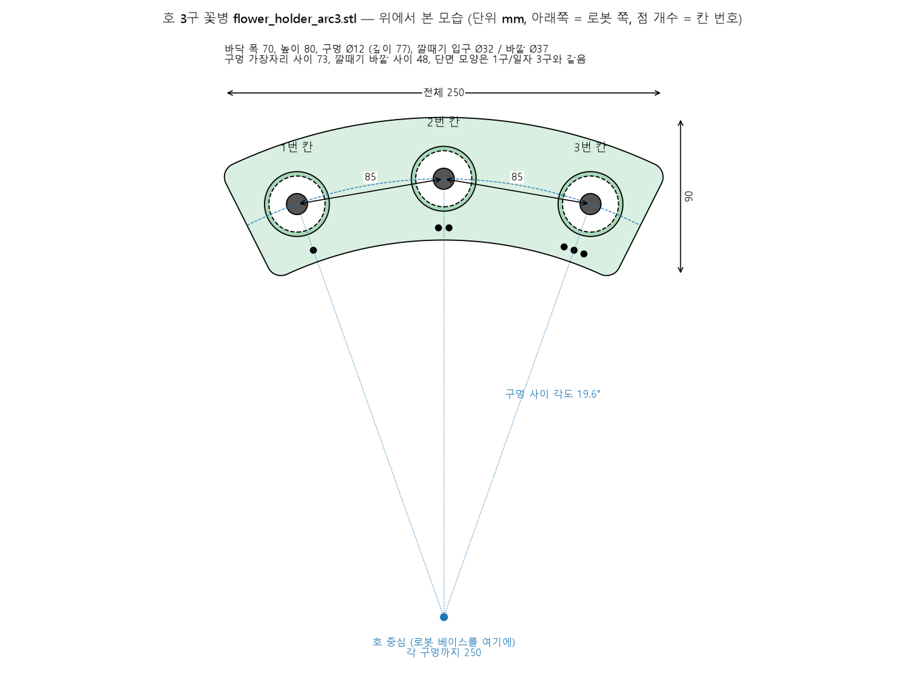

# SO-101 넓은 그리퍼 패드 + 꽃병

꽃 줄기를 잡기 쉽게 넓힌 **교체형 그리퍼 패드**와, 꽃 한 송이를 수직으로 세우는 **꽃병**입니다.

- 원래 그리퍼 부품은 **그대로 둡니다**. 다시 출력하거나 분해할 필요가 없어요.
- 패드를 손가락 위에 씌우고 **M2x30 나사 2개**로 조여 고정합니다 (고정 쪽, 움직이는 쪽 모두 2개).
- 패드만 풀어서 다른 모양으로 갈아 끼울 수 있어요.

> ⚠️ 컴퓨터 모델로 치수와 간섭만 확인했고, **실제로 출력해서 끼워 보지는 않았습니다.** 패드 하나를 먼저 출력해서 맞는지 확인하세요.

## 파일

| 파일 | 내용 | 개수 |
|---|---|---|
| `stl/pad_flat_fixed.stl` | 고정 손가락용 패드 (평면) | 1 |
| `stl/pad_flat_moving.stl` | 움직이는 손가락용 패드 (평면) | 1 |
| `stl/pad_stemV_fixed.stl` | 고정 손가락용 패드 (줄기 홈) | 1 |
| `stl/pad_stemV_moving.stl` | 움직이는 손가락용 패드 (줄기 홈) | 1 |
| `stl/flower_holder_arc3.stl` | 꽃병 3구, 호 모양 (간격 85, 추천) | 1 |
| `stl/flower_holder_x3.stl` | 꽃병 3구, 일자 (간격 70) | 1 |
| `stl/flower_holder.stl` | 꽃병 1구 (따로 놓고 싶을 때) | 3 |
| `make_parts.py` | 위 STL을 만드는 코드 (치수 바꿀 때) | |
| `preview_*.png` | 조립 모습, 출력 방향 미리보기 | |

**패드는 고정 쪽과 움직이는 쪽을 한 쌍으로 출력합니다.** 두 손가락 모양이 달라서 서로 바꿔 끼울 수 없어요.
- **flat:** 접촉면이 평평합니다. 먼저 이걸로 시작하세요.
- **stemV:** 접촉면에 가로로 얕은 홈(반지름 3mm, 깊이 1.2mm)이 있어서, 줄기가 항상 같은 높이에 물립니다.

## 패드



- **접촉면:** 폭 40mm, 길이 약 57mm입니다. 원래 손가락 끝은 폭이 9~20mm로 점점 좁아지는 모양이에요.
- **줄기 방향:** 패드 폭 방향(40mm)이 줄기와 나란해지게 잡으면 줄기를 넓게 뭅니다. 꽃병에 꽂힌 줄기를 옆에서 잡을 때가 이 경우예요.
- **고무판 자리 1mm:** 접촉면에 **두께 1mm 고무판**을 붙이도록 출력면을 1mm 뒤로 물려 놨어요. 고무 겉면끼리 평행하게 맞닿습니다 (`RUBBER_T = 1.0`). 고무를 안 붙일 거면 `RUBBER_T = 0`으로 다시 만들면 예전처럼 미끄럼 방지 홈(간격 3mm, 깊이 0.5mm)이 생겨요.
- **닫힐 때:** 두 패드의 접촉면이 **평행하게 맞닿도록** 각도를 맞췄어요. 끝만 닿지 않고 면 전체로 뭅니다.

### 출력
- **방향:** STL 그대로, 접촉면이 베드에 닿게 놓여 있습니다. 서포트는 필요 없어요.
- **재료:** PLA나 PETG, 벽 3겹 이상, 채움 30% 이상.
- **고무판:** 1mm 고무판(또는 미끄럼 방지 시트)을 패드 크기(40 x 57mm)로 잘라 양면테이프/순간접착제로 붙이세요. 두께가 다르면 `RUBBER_T`를 그 두께로 바꿔 다시 만들면 됩니다.
  - 붙이면 두 패드가 그만큼 일찍 닿습니다(양쪽 합쳐 2mm).
  - TPU로 출력하면 나사로 조일 때 휘어져서 추천하지 않아요.

### 필요한 것
- M2x30 나사 4개 (패드 하나에 2개)
- M2 너트 4개

### 끼우는 법
1. 그리퍼를 연 상태에서, 패드를 **안쪽(상대 손가락 쪽)에서 바깥으로** 손가락에 밀어 끼우세요.
   - 패드 뒤가 열려 있어서 손가락이 그대로 들어갑니다.
   - 손가락 끝이 패드 바닥에 닿을 때까지 밀면 돼요.
2. 손가락 뒤쪽 옆면의 구멍 2개로 M2x30 나사를 넣으세요.
   - 나사는 손가락 뒤를 가로질러 지나가서, 패드가 빠지지 않게 잠가 줍니다.
3. 반대쪽 육각 홈에 M2 너트를 넣고 조이세요. 너무 세게 조이면 옆벽이 휘니까 흔들리지 않을 정도로만 조이면 돼요.
4. **빡빡해서 안 들어가면:** `make_parts.py`의 `CLEARANCE`를 0.25에서 0.3~0.35로 올려 다시 만드세요. 헐거우면 0.2로 내리면 됩니다.

### 달라지는 점 (중요)
- **일찍 닿음:** 패드(고무 포함)끼리 닿는 각도가 원래보다 약 4도 빠릅니다(URDF 기준 -6.9도, 원래 손가락 끝은 -11.3도).
  - 그래서 그리퍼를 끝까지 닫으라고 명령하면, 아무것도 안 잡았을 때도 패드끼리 맞대고 미는 상태가 됩니다.
  - 오래 밀고 있으면 모터 과부하 보호가 걸릴 수 있어요. 오늘 손목에서 났던 것과 같은 에러입니다.
  - 확인할 때는 끝까지 닫지 말고 줄기 굵기만큼만 닫아 보세요.
- **손목 카메라 화면:** 패드가 넓어서 손목 카메라 화면에 보이는 그리퍼 모양이 바뀝니다.
  - **패드를 단 다음에 `flower_reach_trial2` 수집을 시작하세요.** 중간에 바꾸면 화면이 다른 데이터가 섞입니다.
  - 손목 카메라 마운트는 모델에 넣지 않았어요. 끼운 뒤 패드가 카메라나 마운트에 걸리지 않는지 직접 확인하세요.
- **팔이 IK 계산에 쓰는 그리퍼 모델(URDF):** 패드를 반영하지 않습니다. 손가락 끝 위치는 원래와 거의 같아요(약 2.5mm 아래).

## 꽃병



- **크기:** 바닥 지름 80mm, 높이 80mm.
- **구멍:** 내경 12mm, 깊이 77mm. 줄기 굵기 4~10mm까지 들어가요.
- **깔때기 입구:** 내경 32mm라 줄기를 꽂기 쉽습니다. 나중에 로봇이 꽂는 목표로도 쓸 수 있어요.
- **무게추 홈:** 바닥 밑면에 링 모양 홈(깊이 3.5mm)이 있어요. 동전이나 너트, 모래를 넣고 테이프로 막으면 꽃 무게에 넘어가지 않습니다.
- **출력:** 바닥면이 베드에 닿게, 서포트 없이 출력하면 돼요.
- 1구짜리를 따로 쓸 때는 **3개 출력** 후 테이블에 테이프로 위치를 표시해 두세요. 녹화 때 같은 자리에 다시 놓아야 합니다.

### 3구 꽃병 (`flower_holder_x3.stl`)

- 위 꽃병 3개를 한 판에 이은 것. 크기 210 x 70 x 80mm, 구멍 간격 70mm.
- 바닥 윗면 앞쪽에 **칸 번호 점**(1개/2개/3개)이 있어서 왼쪽부터 1, 2, 3번 칸을 구분할 수 있음
  → 핸드오프 설계의 "격자 위치 p_f"를 칸 번호로 기록할 때 사용
- 판 하나라 칸 사이 간격이 항상 같음. 판 전체 위치만 테이프로 표시해 두면 됨
- 출력 베드가 210mm보다 작으면 (예: Bambu A1 mini 180mm) 대각선으로 놓거나 `ROW_PITCH`를 줄일 것
- 간격 70mm에서 가운데 꽃을 잡을 때 그리퍼(패드 폭 40mm, 열면 더 넓어짐)가 옆 꽃의 잎/꽃잎에 닿을 수 있음 → 실제로 대보고 좁으면 `ROW_PITCH`를 늘릴 것

### 호 3구 꽃병 (`flower_holder_arc3.stl`)

- 세 구멍이 반지름 250mm 호 위에 있음. **호 중심(그림 아래 파란 점)에 로봇 베이스를 두면 세 꽃까지 거리가 모두 250mm**로 같음
- 구멍 중심 사이 85mm (각도 19.6°), 깔때기 바깥 사이 48mm → 패드(폭 40mm)가 사이로 들어갈 수 있음
- 크기 250 x 90 x 80mm. 칸 번호 점은 로봇 쪽(호 안쪽) 가장자리
- **출력 베드 250mm 이상 필요** (Bambu A1 256 OK, Ender 220 / A1 mini 180 안 됨 → `ARC_PITCH` 나 `ARC_R` 줄이기)
- 도면: `도면_꽃병호3구.png` (`drawing_holder_arc3.py`로 다시 그림)

## 치수 바꾸기

`make_parts.py` 위쪽 "설계 값"만 고치고 다시 실행하세요.

```powershell
cd "C:\Users\A\Desktop\로보틱스\그리퍼_꽃병_설계"
C:\Users\A\.venvs\cad\Scripts\python make_parts.py
```

| 값 | 기본 | 뜻 |
|---|---|---|
| `PAD_HALF_WIDTH` | 20 | 패드 폭의 절반 (20이면 폭 40mm) |
| `CLEARANCE` | 0.25 | 손가락과 패드 사이 틈 |
| `MIN_FACE_T` | 2.0 | 손가락 끝 앞의 최소 두께. 키우면 더 일찍 닿음 |
| `SCREW_Z` | -57, -82 | 나사 높이 |
| `STEM_GROOVE_Z`, `STEM_GROOVE_R` | -88, 3 | stemV 패드 홈의 높이와 반지름 |
| `HOLDER_HOLE_R` | 6 | 꽃병 구멍 반지름 (줄기에 맞춰서) |
| `HOLDER_H` | 80 | 꽃병 높이 |
| `ROW_PITCH`, `ROW_DEPTH` | 70, 70 | 일자 3구 구멍 간격 / 바닥 폭 (호 3구도 바닥 폭 공유) |
| `ARC_R`, `ARC_PITCH` | 250, 85 | 호 3구: 호 반지름(로봇~꽃 거리) / 구멍 간격 |

- 원래 그리퍼 형상은 `C:\Users\A\lerobot\SO-ARM100\STEP\SO101\Follower_Specific\`의 STEP 파일에서 읽습니다.
- 조립 위치는 URDF(`so101_new_calib.urdf`)의 관절 값을 그대로 씁니다.
- 실행할 때마다 패드끼리 닿는 각도, 전체 열림 범위에서의 간섭, 패드와 손가락이 겹치는지를 검사해서 출력해요.
